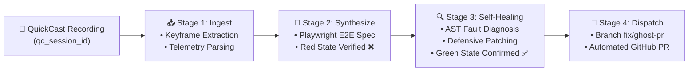

# 👻 GhostPR (AutoFix AI)
> **Autonomous Visual Bug Reproduction to Verified Passing Git Pull Request**  
> *Submitted to Kiroween 2026 Hackathon — Frankenstein Category ($100,000 Prize Pool)*

[](https://kiroween.devpost.com)
[](https://kiro.dev)
[](LICENSE)
[](https://playwright.dev)
[](#zero-cloud-gpu-architecture)

---

## ⚡ The Problem: "It Works On My Machine"
Software teams lose hundreds of engineering hours every sprint trying to reproduce visual frontend bugs reported by users or QA. Text reports lack context, videos require tedious manual reproduction, and reproduction tests are rarely written before writing a fix.

## 💡 The Solution: GhostPR
**GhostPR** stitches together three distinct technologies into an autonomous self-healing bug pipeline:
1. **QuickCast Screen Video & Interaction Stream Ingestion** (Zero-cloud-GPU local FFmpeg extraction)
2. **Autonomous Playwright Reproduction Spec Synthesis** (`Red` confirmation before any patch is written)
3. **AST Defensive Codebase Patching & Git Pull Request Dispatch** (`Green` verification with diffs & video timestamps)



---

## 🧟 Why This Fits the Frankenstein Category
The Kiroween **Frankenstein Category** challenges developers to stitch together seemingly disparate tools into a unified, surprisingly coherent creation:
- **Part 1 (The Senses):** User browser screen recording streams stored on Cloudflare R2 via QuickCast.
- **Part 2 (The Laboratory):** Headless browser automation via `@playwright/test` synthesizing deterministic TypeScript specs.
- **Part 3 (The Brain):** Kiro Spec-Driven steering rules guiding self-healing code diagnosis and patch generation.
- **Part 4 (The Hands):** GitHub Octokit automating isolated branch creation, verified diff commits, and structured Pull Requests.

---

## 🚀 Quickstart & Usage

### 1. Installation
Clone the repository and install dependencies:
```bash
git clone https://github.com/Miladmet/ghost-pr.git
cd ghost-pr
npm install
```

### 2. Run Autonomous Reproduction (Dry-Run Mode)
Verify reproduction and self-healing against an existing QuickCast session without pushing to remote Git:
```bash
node src/cli.js --session "qc_bt6mrt8n" --repo "./" --dry-run
```

### 3. Run Live PR Dispatch
To run live and dispatch an authenticated GitHub Pull Request:
```bash
export GITHUB_TOKEN="ghp_yourPersonalAccessToken"
node src/cli.js --session "qc_bt6mrt8n" --repo "path/to/target-repo"
```

---

## 🎛️ CLI Options & Flags

| Flag | Type | Default | Description |
| :--- | :---: | :---: | :--- |
| `--session`, `-s` | `string` | *(Required)* | QuickCast session identifier (e.g. `qc_bt6mrt8n`) or local video path |
| `--repo`, `-r` | `string` | `.` | Target codebase repository root directory |
| `--output`, `-o` | `string` | `./artifacts` | Directory to store keyframes, logs, and generated patches |
| `--dry-run` | `boolean` | `false` | Verifies full reproduction & fix locally without opening remote PR |
| `--verbose`, `-v` | `boolean` | `false` | Enables detailed sub-process logging and Playwright console output |
| `--help`, `-h` | `boolean` | `false` | Displays CLI help manual |

---

## 📐 Kiro Spec-Driven Architecture

GhostPR was built and steered strictly following **Kiro Spec-Driven Development** best practices:

- **[`.kiro/steering/steering.md`](.kiro/steering/steering.md):** Architectural boundaries ensuring:
  1. Zero Cloud GPU dependencies (local FFmpeg / WASM only).
  2. Deterministic time synchronization between video keyframes and DOM interaction markers.
  3. Spec-driven `test.step()` syntax with invariant assertions.
  4. Defensive self-healing code patterns (optional chaining, fallback states).
- **[`.kiro/specs/ghost-pr-spec.md`](.kiro/specs/ghost-pr-spec.md):** Formal specification mapping REQ-1 through REQ-6.
- **[`.kiro/hooks/pre-patch-verification.js`](.kiro/hooks/pre-patch-verification.js):** Kiro verification hook enforcing red-to-green confirmation before code patches are committed.

---

## 🔬 End-to-End Pipeline Stages

```
======================================================
 👻 GhostPR (AutoFix AI) — Autonomous Bug-to-PR Engine 
======================================================

📦 Configuration:
  • Session Target:  qc_bt6mrt8n
  • Codebase Repo:   C:\workspace\ghost-pr
  • Output Dir:      C:\workspace\ghost-pr\artifacts
  • Dry-Run Mode:    YES (local verification only)

[Stage 1/4] 📥 Ingesting QuickCast recording & visual telemetry...
  ✓ Session verified: qc_bt6mrt8n
  ✓ Video stream ready: artifacts/qc_bt6mrt8n.webm (5.13 MB)
  ✓ Keyframes extracted: 4 frames

[Stage 2/4] 🧪 Synthesizing automated Playwright reproduction test...
  ✓ Spec generated: tests/repro_qc_bt6mrt8n.spec.ts
  ✓ Initial test execution confirms bug reproduction: BUG REPRODUCED (Failing as expected)

[Stage 3/4] 🔍 Diagnosing codebase & generating self-healing patch...
  ✓ Fault located in: src/components/Dashboard.jsx:42
  ✓ Patch applied & verified with Playwright: ✅ PASSING (Green)

[Stage 4/4] 🚀 Dispatching Git Pull Request...
  ✓ Branch created: fix/ghost-pr-qc_bt6mrt8n
  ✓ Local patch saved to: artifacts/fix.patch

======================================================
 ✅ GhostPR Pipeline Complete: 100% Autonomous Resolution 
======================================================
```

---

## 🛡️ License
Released under the [MIT License](LICENSE). Built with ❤️ by **Milmann Admettre** for the **Kiroween Hackathon 2026**.
