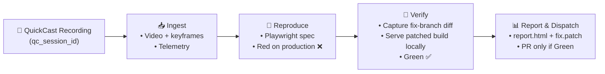
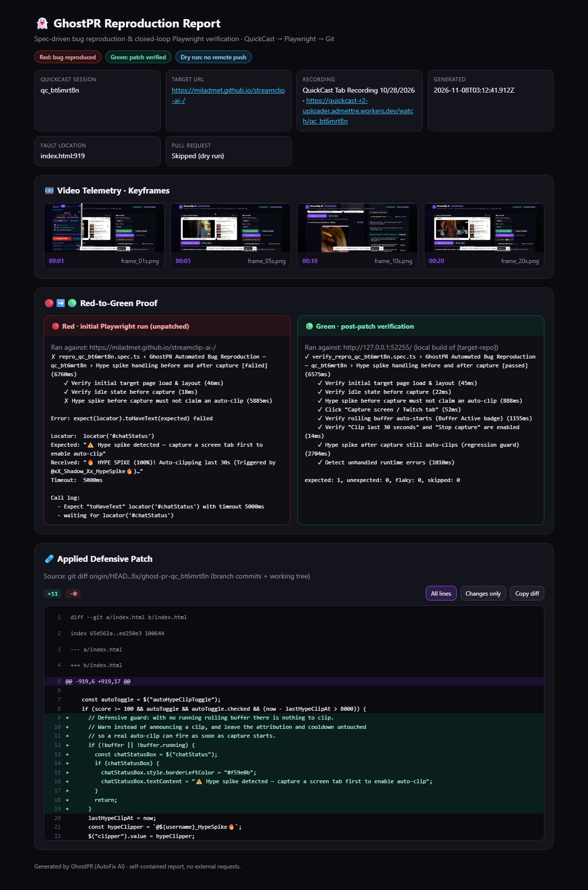

# 👻 GhostPR
> **Spec-driven autonomous bug reproduction and closed-loop Playwright verification engine**  
> *Kiroween 2026 Hackathon — Frankenstein Category*

[](https://kiroween.devpost.com)
[](https://kiro.dev)
[](LICENSE)
[](https://playwright.dev)
[](#-zero-cloud-gpu)

---

## ⚡ The Problem: "It Works On My Machine"
Software teams lose hours every sprint trying to reproduce visual frontend bugs reported by users or QA. Text reports lack context, videos require tedious manual reproduction, and regression tests are rarely written before the fix.

## 💡 What GhostPR Does
GhostPR turns a QuickCast screen recording into a Playwright reproduction, **proves the bug fails on the live build (Red)**, and **proves a candidate fix passes on a local build of the fix branch (Green)**. Every run ends with a self-contained HTML report, and a Pull Request whose checklist only ticks what actually happened.

1. **Ingest:** download the session `.webm` from QuickCast (Cloudflare R2), extract keyframes locally with FFmpeg, and parse interaction markers when the session has them.
2. **Reproduce (Red):** reuse a refined spec from `tests/`, or synthesize a baseline `test.step()` spec, and run it against production. GhostPR only reports *reproduced* when a real assertion fails; Playwright infrastructure errors are reported as inconclusive.
3. **Verify (Green):** capture the real patch from the target repo's git (`fix/ghost-pr-<id>` vs. `origin`), serve that build on `127.0.0.1`, and re-run the same spec. Green comes only from a real passing run.
4. **Report & dispatch:** write `artifacts/report.html` and `artifacts/fix.patch`. In live mode, commit the spec and patched files on the fix branch and open a PR, but only if Green passed.



### Who does what
| Step | Done by |
| :--- | :--- |
| Record the bug | User, with QuickCast |
| Ingest, run Red, capture the patch, serve the build, run Green, report, PR | **GhostPR, automatically** |
| Reproduction spec for `qc_bt6mrt8n` | Refined with Kiro from the session keyframes (the session has no interaction markers) |
| The fix | Written by Kiro under steering directive 4 (defensive guard), committed on `fix/ghost-pr-qc_bt6mrt8n` |

GhostPR's built-in patch generator is a simple null-check rewriter. Autonomous patch synthesis is on the roadmap (REQ-8).

---

## 🧪 Case Study: `qc_bt6mrt8n` (StreamClip AI)

[](https://miladmet.github.io/ghost-pr/)

- **Bug:** clicking *Simulate Chat Hype Spike* before any capture showed "Auto-clipping last 30s…" and overwrote the clip attribution, but no clip was made. It also started the 8-second cooldown.
- **Red:** fails on production at step *"Hype spike before capture must not claim an auto-clip"*.
- **Fix:** an 11-line defensive guard in `recordChatHype()`, on branch [`fix/ghost-pr-qc_bt6mrt8n`](https://github.com/Miladmet/streamclip-ai-/tree/fix/ghost-pr-qc_bt6mrt8n).
- **Green:** all 8 steps pass on a local build of the fix branch (3/3 repeats), including a check that auto-clip still works after capture.
- **Interactive report:** [**🌐 View Live Interactive Report**](https://miladmet.github.io/ghost-pr/) (hosted on GitHub Pages) or inspect [`docs/sample-report.html`](docs/sample-report.html). It is self-contained and makes zero external network requests.

The sample report is built from a real run by `npm run sample-report`. Keyframes are cropped to the app viewport (no OS taskbar, browser tabs or bookmarks), and local paths are redacted as `[workspace]` and `[target-repo]`.

---

## 🧟 Why This Fits the Frankenstein Category
- **The Senses:** browser screen recordings stored on Cloudflare R2 via QuickCast.
- **The Laboratory:** headless Chromium via `@playwright/test`, with fake media devices to replay real capture flows.
- **The Brain:** Kiro spec-driven steering rules guiding reproduction, defensive fixes, and verification.
- **The Hands:** git and GitHub Octokit for isolated fix branches, verified commits, and PRs.

---

## 🚀 Quickstart

**Requirements:** Node.js 22+, git. Python 3 with `imageio-ffmpeg` is optional (keyframes only; GhostPR tries `python3`, then `python`).

```bash
git clone https://github.com/Miladmet/ghost-pr.git
cd ghost-pr
npm install
npx playwright install chromium
pip install imageio-ffmpeg   # optional: keyframe extraction
```

### Run the Red ➔ Green case study (dry run, nothing is pushed)
```bash
git clone https://github.com/Miladmet/streamclip-ai- ../streamclip-ai-
git -C ../streamclip-ai- switch fix/ghost-pr-qc_bt6mrt8n
node src/cli.js --session qc_bt6mrt8n --repo ../streamclip-ai- --dry-run
```
Expected result: `✅ GhostPR: Red ➔ Green Verified (fails on baseline, passes on patched build)`. Outputs: `artifacts/report.html` and `artifacts/fix.patch`.

### Run the reproduction spec on its own
```bash
npm test
```
This runs `tests/repro_qc_bt6mrt8n.spec.ts` against the live site. **It fails on purpose:** the bug is still on production, and the fix lives on the branch above.

### Live PR dispatch
```bash
export GITHUB_TOKEN="<your token>"
node src/cli.js --session qc_bt6mrt8n --repo ../streamclip-ai-
```
A PR is only opened when Green passed.

---

## 🎛️ CLI Options

| Flag | Type | Default | Description |
| :--- | :---: | :---: | :--- |
| `--session`, `-s` | `string` | *(required)* | QuickCast watch URL or session ID (e.g. `qc_bt6mrt8n`) |
| `--repo`, `-r` | `string` | *(required)* | Target repository root |
| `--url`, `-u` | `string` | from session | Override the target web app URL |
| `--output`, `-o` | `string` | `./artifacts` | Keyframes, specs, `fix.patch`, `report.html` |
| `--dry-run` | `boolean` | `false` | Reproduce and verify locally; never push or open a PR |
| `--verbose` | `boolean` | `false` | Detailed stage logging |
| `--help`, `-h` | `boolean` | `false` | Show help |
| `--version`, `-v` | `boolean` | `false` | Show version |

Exit code is `0` for Red ➔ Green verified or baseline maintained, and `1` when a reproduced bug isn't healed or Playwright couldn't run.

---

## 📐 Kiro Spec-Driven Architecture
- **[`.kiro/steering/steering.md`](.kiro/steering/steering.md):** zero cloud GPU, scoped `test.step()` specs, defensive fixes, Red ➔ Green verification, `fix/ghost-pr-<id>` branches. Directive 2 (`performance.now()`-anchored interaction markers) is on the roadmap: current QuickCast sessions don't carry markers yet.
- **[`.kiro/specs/ghost-pr-spec.md`](.kiro/specs/ghost-pr-spec.md):** REQ-1 to REQ-7 implemented; REQ-8 (autonomous patch synthesis) on the roadmap.

---

## 💸 Zero Cloud GPU
Ingestion, keyframe extraction, both Playwright runs, and the verification server all run on your machine. Nothing is uploaded and no GPU is rented.

---

## 🔬 Sample Output (real run, paths shortened)
```
[Stage 2/4] 🧪 Synthesizing automated Playwright reproduction test...
  ✓ Refined spec reused: tests/repro_qc_bt6mrt8n.spec.ts
  ✓ Initial test execution confirms bug reproduction: BUG REPRODUCED (Failing as expected)

[Stage 3/4] 🔍 Diagnosing codebase & generating self-healing patch...
  ✓ Fault located in: index.html:919
  ✓ Patch captured from git diff origin/HEAD...fix/ghost-pr-qc_bt6mrt8n (branch commits + working tree)
  ✓ Post-patch verification (http://127.0.0.1:<port>/ (local build)): ✅ PASSING (Green)

[Stage 4/4] 🚀 Dispatching Git Pull Request...
  ℹ Dry-run mode enabled. Skipping remote Git push.
  ✓ Visual HTML report generated: artifacts/report.html

======================================================
 ✅ GhostPR: Red ➔ Green Verified (fails on baseline, passes on patched build)
======================================================
```

---

## 🛡️ License
Released under the [MIT License](LICENSE). Built by **Milmann Admettre** with Kiro for the **Kiroween 2026 Hackathon — Frankenstein Category**.
